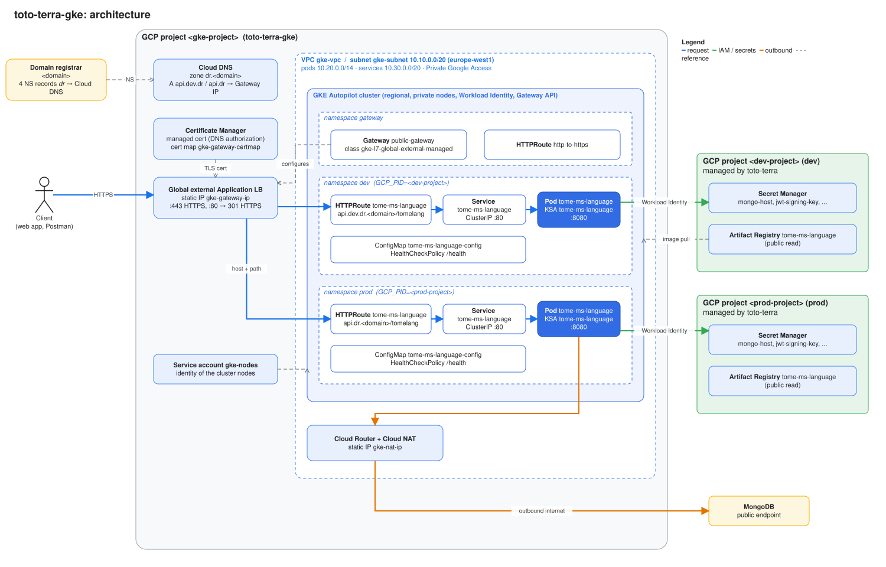
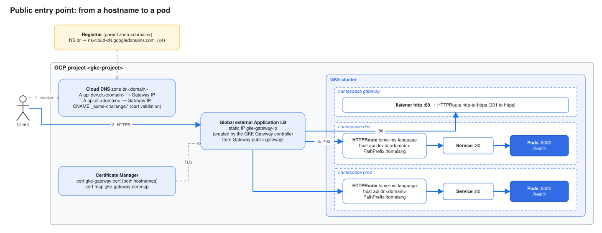

# Architecture

Everything below lives in one GCP project, `<gke-project>`, in region `europe-west1`. The exceptions are the secrets and images, which stay in `<dev-project>` and `<prod-project>`, managed by `toto-terra`.

## 1. Network (`cluster/network.tf`)

| Resource | Value | Why |
|---|---|---|
| VPC `gke-vpc` | no auto subnets | Keeps the cluster isolated from the rest of the project |
| Subnet `gke-subnet` | `10.10.0.0/20` | Node IPs |
| Secondary range `gke-pods` | `10.20.0.0/14` | Pod IPs (VPC-native cluster) |
| Secondary range `gke-services` | `10.30.0.0/20` | ClusterIP Service IPs |
| Private Google Access | on | Private nodes reach Google APIs (Secret Manager, Artifact Registry, ...) without a public IP |
| Cloud Router + Cloud NAT `gke-nat` | static IP `gke-nat-ip` | Outbound internet for private nodes (MongoDB, external APIs) from one fixed IP that can be allowlisted (`terraform output gke_nat_ip`) |

## 2. Cluster (`cluster/gke.tf`)

- **GKE Autopilot**, regional. Google manages the nodes, and you pay per pod request, so there is no node pool to size. Nodes are created on demand from the pods' `resources.requests`.
- **Private nodes, public control plane.** Nodes have no public IP. The control plane endpoint stays public so the Terraform VM can reach it, but access still requires Google IAM and Kubernetes RBAC.
- **Node service account `gke-nodes`.** A minimal identity for the nodes, used instead of the default Compute Engine account. Pods don't use it: they use Workload Identity.
- **Workload Identity** is always on in Autopilot. The pool is `<gke-project>.svc.id.goog` (see [workload-identity.md](workload-identity.md)).
- **Gateway API** (`CHANNEL_STANDARD`) installs the Gateway CRDs and the GKE Gateway controller.
- **Release channel `REGULAR`** and `deletion_protection = true`.

## 3. Public entry point (`cluster/edge.tf` + `workloads/gke.tf`)

All services and environments share **one** load balancer.

- **DNS.** The parent domain stays at the registrar. Only the subdomain `dr.<domain>` is delegated to Cloud DNS, through 4 NS records named `dr` at the registrar (`terraform output domain_name_servers`). The delegation can later move to another GCP project without touching the parent domain.
- **Certificate.** A Google-managed certificate covering both hostnames, validated by DNS authorization: Terraform writes the validation CNAME records into the Cloud DNS zone. A certificate map lets the Gateway pick it per hostname.
- **Gateway** (`workloads/gke.tf`, namespace `gateway`). The Kubernetes object that the GKE controller turns into the load balancer. It uses the static IP (`NamedAddress`) and the certificate map (annotation `networking.gke.io/certmap`), both read from `cluster/` outputs.
  - Listener `https` (443) accepts routes only from the `dev` and `prod` namespaces.
  - Listener `http` (80) only serves the `http-to-https` redirect.
- **HTTPRoute per service and environment.** It attaches to the `https` listener, matches the environment's hostname plus the service's base path (`PathPrefix /tomelang`), and forwards to the service's ClusterIP Service.
- **HealthCheckPolicy per service.** The load balancer checks `/` by default, and the services only answer on `/health`.

Why a Gateway rather than a `LoadBalancer` Service per service: one IP, one certificate and one load balancer for everything. A new service only adds an HTTPRoute.

## 4. Workloads (`workloads/`)

| Object | Per | Notes |
|---|---|---|
| Namespace `dev`, `prod` | environment | `local.environments` maps env → GCP project (`<dev-project>`, `<prod-project>`) |
| ServiceAccount `<service>` | service × env | Its name and namespace form the pod's GCP identity |
| ConfigMap `<service>-config` | service × env | `HYPERSCALER=gcp`, `GCP_PID=<env project>`, loaded through `envFrom` |
| Deployment `<service>` | service × env | Image `europe-west1-docker.pkg.dev/<env project>/<service>/<service>:<tag>`, probes on `/health`, requests and limits |
| Service `<service>` | service × env | ClusterIP, port 80 → container port `http` (8080) |
| HTTPRoute + HealthCheckPolicy | service × env | See above |
| Role + RoleBinding `ci-deployer` | env | Lets `toto-cicd@<env project>` (the CI service account of the service repos) update Deployments in that namespace only |

**Who owns what.** Terraform owns the shape of each workload (KSA, ConfigMap, Deployment skeleton, Service, HTTPRoute, HealthCheckPolicy). **CI owns which image runs**: GitHub Actions in each service repo builds the image and runs `kubectl set image` + `kubectl rollout status` (feature branches → `dev`, `main` → `prod`). The Deployment's image is in `lifecycle.ignore_changes`, so a `terraform apply` doesn't revert it.

The **image tag** variables (`TF_VAR_<service>_image_tag`, for example `{"dev":"1.2.0","prod":"1.1.0"}`) only set the image when Terraform creates the Deployment (first apply, new environment, recreation).

CI authenticates with the existing `toto-cicd` Google service account of each toto project. It needs `roles/container.clusterViewer` on `<gke-project>` to fetch credentials (granted by hand, see [operations.md](operations.md)) and gets its Kubernetes rights only from the `ci-deployer` Role.

**Images** are pulled from the environment's Artifact Registry repository, which `toto-terra` makes publicly readable. That is why the nodes need no registry permission.

## 4b. Agents: KEDA, Pub/Sub and `agents-<env>` (`platform/` + `workloads/agent-coder.tf`)

Agents (today `agent-coder`: one GitHub issue in, one PR out, then exit) are batch jobs, not services. They run in their own namespaces, `agents-dev` and `agents-prod`, and are started from a queue.

| Object | Where | Notes |
|---|---|---|
| KEDA (Helm chart, pinned) in namespace `keda` | `platform/` | Separate Terraform root, applied before `workloads/`: the KEDA CRDs must exist when `workloads/` is planned |
| `roles/monitoring.viewer` on `<gke-project>` for `keda/keda-operator` | manual grant | The Pub/Sub scaler reads the backlog from Cloud Monitoring |
| Topic `agent-coder-tasks-<env>`, pull subscription `...-sub`, DLQ topic `...-dlq` + subscription `...-dlq-sub` | `workloads/`, in `<gke-project>` | Exactly-once delivery, ack deadline 600s, 7 days retention, dead-letter after 5 delivery attempts (the minimum Pub/Sub allows) |
| ServiceAccount `agent-coder` in `agents-<env>` | `workloads/` | Subscriber on its own subscription only (manual grant); grants in the toto projects are in `toto-terra` |
| TriggerAuthentication + ScaledJob `agent-coder` | `workloads/` | `gcp-pubsub` trigger, one pod per message |
| Role + RoleBinding `ci-deployer` | `workloads/` | `get`/`patch` on `scaledjobs`, read on `jobs`/`pods`, for `toto-cicd@<env project>` |

`agents-dev` maps to `<dev-project>` and `agents-prod` to `<prod-project>`, like `dev` and `prod`. Pub/Sub lives in `<gke-project>`, not in the toto projects.

**Flow.** A message `{"taskId": "<id>"}` is published on `agent-coder-tasks-<env>`. KEDA polls the backlog every 30 s and creates one Job per message, up to `agent_coder_max_replicas` at once (default 10). Each pod pulls one message, extends its lease while it works, acks or nacks, and exits. `task.json` stays in `gs://<toto project>-agents-data/coder/<taskId>/task.json`; only the id travels on the queue.

**Retries** come from Pub/Sub, not Kubernetes (`backoffLimit: 0`): a nacked or expired message is redelivered, and after 5 attempts it goes to the DLQ subscription, where it is kept for inspection or replay. `activeDeadlineSeconds` (3h15m) is a hard backstop above the runner's own 3h timeout, and the pods are annotated `safe-to-evict: "false"` so autoscaling doesn't kill a run.

**Scaling strategy.** `default`: it subtracts the running jobs from the backlog. The Pub/Sub backlog includes messages that are leased but not acked yet, so without that, every poll would start new jobs for messages already being worked on.

**Who owns what.** As for the services: Terraform owns the shape of the ScaledJob, **CI owns the image** (it patches the ScaledJob). `lifecycle.ignore_changes` doesn't work for that on a `kubernetes_manifest` (the provider still sends the whole manifest), so Terraform reads the live image back from the cluster (`data.kubernetes_resources`) and sends it unchanged, with `force_conflicts` to take field ownership back from CI (`kubectl-patch`) and KEDA. `var.agent_coder_image_tag` is only used when the ScaledJob doesn't exist yet. Only `agents-dev` is deployed by CI for now: the prod namespace and infrastructure are prepared, but nothing releases to it yet.

## 5. Secrets and configuration

The `totoms` SDK reads its secrets from `projects/$GCP_PID/secrets/<name>` at startup, before it starts listening, with fixed names (`mongo-host`, `jwt-signing-key`, ...). Setting `GCP_PID` per namespace is what points `dev` to `<dev-project>` and `prod` to `<prod-project>`. The secrets never leave those projects, and nothing secret is stored in this repo or in Kubernetes.

## 6. Who runs Terraform

A GCP VM (`terra`) with Application Default Credentials from its service account, so no key file is involved. The VM needs the `cloud-platform` access scope; the actual permissions are restricted by IAM on that service account. The state and its lock live in the GCS bucket `toto-terra-gke-dr`. See [diagrams/terraform-layout.drawio.svg](diagrams/terraform-layout.drawio.svg) and [operations.md](operations.md).
