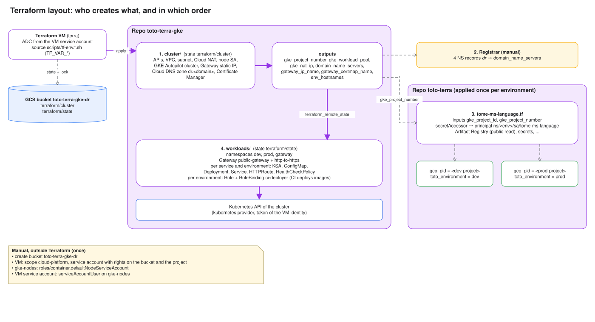

# Operations



## First setup (in order)

**0. Manual prerequisites (once)**

- Create the GCS bucket `toto-terra-gke-dr` (Terraform state).
- Create the Terraform VM:
  - access scope `cloud-platform`
  - a service account with rights on the bucket and on what Terraform manages in the project (compute, container, DNS, Certificate Manager, service accounts)
- Create your env file from `scripts/tf-env.template.sh` (e.g. `scripts/tf-env.dev.sh`, gitignored), run `chmod 600` on it, and `source` it in every session. It contains no secrets, only names and versions.

**1. `cluster/`**

```bash
cd cluster && terraform init && terraform apply
```

The VM does not have IAM admin rights on the project, so after the first apply, grant these by hand (Console or gcloud):

```bash
gcloud projects add-iam-policy-binding <gke-project> \
  --member="serviceAccount:gke-nodes@<gke-project>.iam.gserviceaccount.com" \
  --role="roles/container.defaultNodeServiceAccount"
```

Also give the VM's service account `roles/iam.serviceAccountUser` on `gke-nodes`, so it can create a cluster whose nodes run as it.

Let the CI service accounts of the service repos fetch cluster credentials (`get-gke-credentials` / `gcloud container clusters get-credentials`). `roles/container.clusterViewer` only grants `container.clusters.get`/`list`: it gives no rights inside the cluster. Those come from the `ci-deployer` Role in `workloads/` (see "Deploy a new version of a service").

```bash
gcloud projects add-iam-policy-binding <gke-project> \
  --member="serviceAccount:toto-cicd@<dev-project>.iam.gserviceaccount.com" \
  --role="roles/container.clusterViewer"
gcloud projects add-iam-policy-binding <gke-project> \
  --member="serviceAccount:toto-cicd@<prod-project>.iam.gserviceaccount.com" \
  --role="roles/container.clusterViewer"
```

**2. Registrar.** Create 4 NS records named `dr` with the values of `terraform output domain_name_servers`. Do **not** change the domain's own nameservers. Until the delegation has propagated, the certificate stays `PROVISIONING`.

**3. toto-terra.** Set `gke_project_id` and `gke_project_number` (`terraform output gke_project_number`), then apply on `<dev-project>` and on `<prod-project>`. This grants the pods access to their secrets.

**4. `workloads/`**

```bash
cd workloads && terraform init && terraform apply
```

## Deploy a new version of a service

Deploys happen through **CI in the service repo** (GitHub Actions), not through Terraform:

- push on `feature/**` (and `issue/**` where the repo uses it) → builds the image and deploys it to namespace `dev`
- push on `main` → builds the image and deploys it to namespace `prod`

The workflow runs `kubectl set image -n <env> deploy/<service> <service>=<image>:<tag>` and then `kubectl rollout status`. Terraform ignores the Deployment's image (`lifecycle.ignore_changes`), so the next `terraform apply` doesn't revert it.

The `TF_VAR_<service>_image_tag` variables are only used when Terraform **creates** a Deployment (first apply, new environment, recreation of the Deployment). Changing them afterwards has no effect.

### Roll back

Either:

- roll back to the previous ReplicaSet: `kubectl rollout undo -n <env> deploy/<service>` (list revisions with `kubectl rollout history -n <env> deploy/<service>`), or
- rerun the CI job of an older commit in the service repo.

A rollback is overwritten by the next CI deploy of that environment.

### CI access to the cluster

CI authenticates with the `toto-cicd` service account of the environment's toto project (GitHub environment secret `CICD_SERVICE_ACCOUNT`, managed by `toto-terra`). Two pieces give it access:

- **GCP IAM** (manual, see first setup): `roles/container.clusterViewer` on `<gke-project>`, to fetch the cluster credentials.
- **Kubernetes RBAC** (`workloads/ci-deployer.tf`): a Role `ci-deployer` in each environment namespace (`deployments`: get/list/watch/patch; `replicasets` and `pods`: get/list/watch), bound to the user `toto-cicd@<env project>.iam.gserviceaccount.com`. The dev SA can only deploy to `dev`, the prod SA only to `prod`.

Check it (as a cluster admin):

```bash
kubectl auth can-i patch deployments -n dev  --as=toto-cicd@<dev-project>.iam.gserviceaccount.com   # yes
kubectl auth can-i patch deployments -n prod --as=toto-cicd@<dev-project>.iam.gserviceaccount.com   # no
kubectl auth can-i patch deployments -n prod --as=toto-cicd@<prod-project>.iam.gserviceaccount.com  # yes
kubectl auth can-i patch deployments -n dev  --as=toto-cicd@<prod-project>.iam.gserviceaccount.com  # no
```

Caution: the Artifact Registry cleanup policy in `toto-terra` deletes old images. Rolling back, or recreating a Deployment from a pinned tag, fails if the image has been deleted.

## Add a new service

1. **This repo:** copy `workloads/tome-ms-language.tf` to `workloads/<service>.tf` and rename everything:
   - resource names, KSA, ConfigMap, Deployment, Service
   - image path and the `<service>_image_tag` variable
   - the HTTPRoute `PathPrefix`, which must be the service's base path
   Add the tag variable to `scripts/tf-env.template.sh` and your env file. It sets the image of the first deploy only.
2. **toto-terra:** in `<service>.tf`, build the principal `ns/<env>/sa/<service>` (same pattern as `tome_ms_language_gke_principal`) and grant it the roles the service needs, at least `secretAccessor`. Apply on both projects.
3. Apply `workloads/`.
4. **Service repo:** add the CI workflow that builds the image and runs `kubectl set image` / `kubectl rollout status` on `deploy/<service>` (feature branches → `dev`, `main` → `prod`). Nothing to add here for CI access: the `ci-deployer` Role is per namespace and covers every Deployment in it.

## Check what runs

```bash
gcloud container clusters get-credentials <cluster-name> --region europe-west1 --project <gke-project>

kubectl get all -n dev
kubectl logs -n dev deploy/tome-ms-language
kubectl get gateway,httproute -A
kubectl describe httproute tome-ms-language -n dev          # accepted by the Gateway?
gcloud certificate-manager certificates describe gke-gateway-cert   # ACTIVE?

# Test without the Gateway
kubectl port-forward -n dev svc/tome-ms-language 8080:80
```

## Troubleshooting

| Symptom | Cause / fix |
|---|---|
| `terraform init` in the repo root says the directory is empty | Run it in `cluster/` or `workloads/` |
| `workloads/` plan: cluster not found | Apply `cluster/` first, and check `TF_VAR_gke_cluster_location` (the region) |
| GCS state lock 403 "Provided scope(s) are not authorized" | The VM's access scope isn't `cloud-platform`: stop the VM, change the scope, restart it |
| 403 on `google_project_iam_member` | The VM has no IAM admin rights by design: grant the role by hand (see step 1) |
| Certificate `PROVISIONING`, `CNAME_MISMATCH` | DNS delegation not propagated yet: check `dig NS dr.<domain>` and the `_acme-challenge` CNAME, then wait |
| Pod crashes at startup with a permission error on secrets | `toto-terra` grant missing or wrong principal (project number, namespace, KSA name) |
| `kubectl logs` shows nothing | Pass the namespace: `-n dev` / `-n prod` |
| CI deploy: `deployments.apps "<service>" is forbidden` | `ci-deployer` Role/RoleBinding missing in that namespace (apply `workloads/`), or CI uses the SA of the other environment |
| CI: 403 `container.clusters.get` when fetching credentials | Manual `roles/container.clusterViewer` grant missing for that `toto-cicd` SA (see first setup) |
| `terraform apply` changes a Deployment's image | It shouldn't: the image is in `ignore_changes`. Check that the Deployment's `lifecycle` block still lists `container[0].image` |
| 502 / no healthy upstream from the Gateway | Health check failing: check the HealthCheckPolicy and that `/health` answers on the container port |
